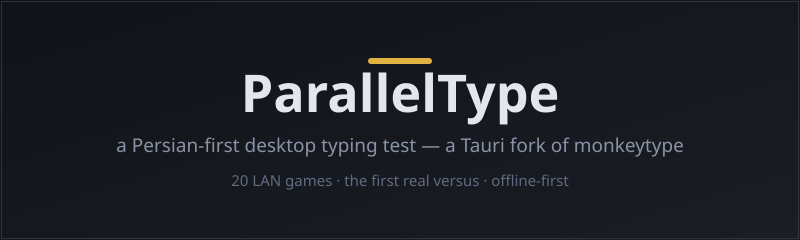

<p align="center">
  
</p>

# ParallelType

**English:** a Persian-first desktop fork of [monkeytype](https://github.com/monkeytypegame/monkeytype) built on Tauri — offline-first typing practice with Persian-specific drills, 24 desktop games, and a complete online wave: **20 head-to-head games over LAN with no external server**, including the first real versus (authoritative-host type-pong with snapshot state-sync at 20/s).

## Download

- Signed Windows installer: **[Releases](https://github.com/gini17924-netizen/Parallel-Type/releases/latest)**
- The in-app updater is live (endpoint: `releases/latest/download/latest.json` from this repo) — future versions ship as a plain GitHub Release, no code change needed.
- ⚠️ Windows Firewall prompts on the first online run — choose **Allow on private networks**.

## The online wave at a glance

| Pattern | Games | Arbitration |
|---|---|---|
| **R** — seeded race to a target | Sky Climber, Endless Runner, Nitro Run, Maze Runner | finish time at the line |
| **S** — score-race (12 games) | Word Blast, Sprint, Ghost GP, Split Duel, Stack Attack, Balloon Pop, Pair Keys, Wordle, Type Snake, Letter Strike, Lane Defense, Fruit Slash, Firefight, Crane, Beat Keys | score / death / horn / survival — per game |
| **H** — hot-seat → LAN | Bot Duel | remote pacer, finishMs |
| **V** — the real versus | Type Pong | authoritative host + 20 snapshots/s; play to N |

- Connect from the `/games/online` lobby: UDP broadcast discovery + one-click join (manual ip+code fallback for AP isolation).
- Shared seeded streams (words never travel) — both machines see identical content.
- Online matches never write local stats; disconnect / leave / tab-switch → void.

## Build from source

```bash
pnpm install
npm run build          # madge + ts-check + vite
npx tauri build        # NSIS + updater signature (TAURI_SIGNING_PRIVATE_KEY required)
```

- Gates: `npx tsc --noEmit` + `npx vitest run` + oxlint (both configs) + `cargo test` in `frontend/src-tauri`.
- The two-device test scenario lives in `TEST_RUN_2_DEVICES.md` (workspace root).

<details>
<summary>🇮🇷 راهنمای فارسی (کلیک کنید)</summary>
<div dir="rtl">

## دربارهٔ ParallelType

پارالل‌تایپ یک فورک دسکتاپیِ فارسی از پروژهٔ [monkeytype](https://github.com/monkeytypegame/monkeytype) است که با **Tauri** برای ویندوز ساخته شده و کاملاً **آفلاین‌محور** کار می‌کند — هیچ سرور یا حساب کاربری خارجی ندارد.

تمرین‌های فارسی اختصاصی: **keybr فارسی** (تولید کلمات بر اساس حروف ضعیف شما) و **smart drill** (برنامه تمرین هوشمند بر اساس آمار خطاها)، نقطه‌گذاری سفارشی با ZWNJ، آمار کامل محلی، Year Wrapped (جمع‌بندی سالانه)، و **۲۴ بازی دسکتاپ**.

## نصب

۱. از صفحهٔ [Releases](https://github.com/gini17924-netizen/Parallel-Type/releases/latest) فایل `ParallelType_0.28.0_x64-setup.exe` را دانلود و نصب کنید.
۲. در اولین اجرای آنلاین، فایروال ویندوز پرامپت می‌دهد → **Allow on private networks** را بزنید.
۳. آپدیت‌ها خودکار است: اپ در پس‌زمینه endpoint همین ریپو را چک می‌کند و نسخهٔ جدید را پیشنهاد می‌دهد.

## بازی دو نفره روی LAN — بدون سرور

۱. هر دو دستگاه به **همان شبکهٔ LAN** وصل باشند (Wi-Fi یا کابل).
۲. از صفحهٔ اصلی → **بازی‌ها** → **online** وارد لابی شوید.
۳. یک نفر **host a match** می‌زند؛ دستگاه دیگر از لیست «nearby» با یک کلیک join می‌کند — یا دستی با **IP + code** (اگر روتور AP isolation دارد و broadcasting را می‌بندد).
۴. یکی از **۲۰ بازی** را انتخاب و start کنید؛ هر دو ماشین هم‌زمان وارد بازی می‌شوند.

- هر دو ماشین محتوای یکسان می‌بینند (استریم‌های seeded مشترک — کلمات رد و بدل نمی‌شوند).
- پنل حریف زنده است: امتیاز/جان/پیشرفت رد و بدل می‌شود.
- **داوری** طبق قواعد خودِ هر بازی: زمان خط پایان، امتیاز بالاتر، حریف بدون اتمام می‌بازد، تساوی دقیق draw.
- اگر یکی وسط بازی خارج شود یا اینترنت قطع شود → مسابقه **void** می‌شود و هیچ چیزی در آمار محلی ثبت نمی‌گردد.
- **مسابقه آنلاین هرگز آمار محلی/استریک/PB را دست نمی‌زند** — آفلاین و آنلاین کاملاً جداهستند.

## عیب‌یابی

| مشکل | راه‌حل |
|---|---|
| دستگاه دیگر در لیست nearby نیست | با IP + code دستی join کنید (AP isolation روتورها broadcast را می‌بندد) |
| اتصال وصل نمی‌شود | فایروال ویندوز پورت 51987 را برای برنامه Allow کنید |
| در دو دستگاه همان نسخه نیست | هر دو از همین Releases نصب کنید؛ آپدیتر نسخه‌های بعد را می‌آورد |
| بازی دوم بعد از اولی عجیب است | باگ نیست؟ خروج کامل از صفحه و ورود مجدد — اگر ادامه داشت گزارش دهید |

## ساخت از سورس

۱. این ریپو را دانلود/clone کنید.
۲. پیش‌نیاز: **Node.js** (LTS) و **Rust** (msvc toolchain).
۳. `pnpm install` سپس `npm run build` سپس `npx tauri build` — خروجی در `frontend/src-tauri/target/release/bundle/nsis/`.
۴. برای امضای آپدیتر، متغیر محیطی `TAURI_SIGNING_PRIVATE_KEY` لازم است (فقط برای انتشار؛ نصب محلی بدون آن هم ساخته می‌شود).

## مجوز و اعتبار

این فورک تحت همان **GPL-3.0** آپ‌استریم منتشر می‌شود؛ کل تاریخچه تغییرات باز است. پروژهٔ پایه: [monkeytype](https://github.com/monkeytypegame/monkeytype) — سپاس از سازندگان آن. فونت فارسی: Vazirmatn.

</div>
</details>

## Credits

- Upstream: [monkeytype](https://github.com/monkeytypegame/monkeytype) — this fork is released under the same **GPL-3.0**; the full change history is open in git.
- Persian font: Vazirmatn.
